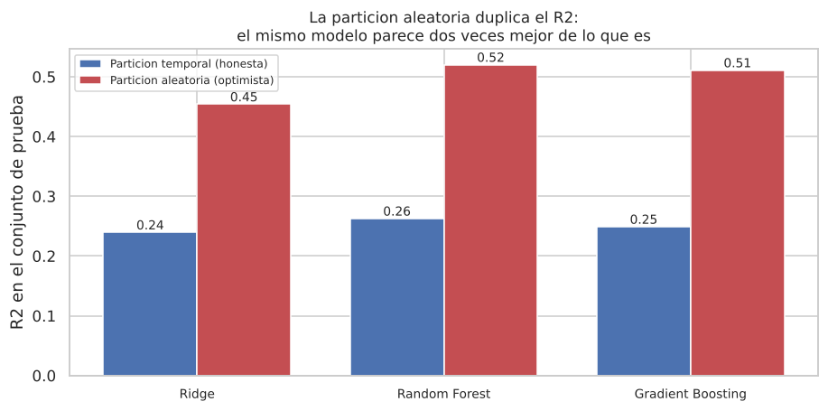
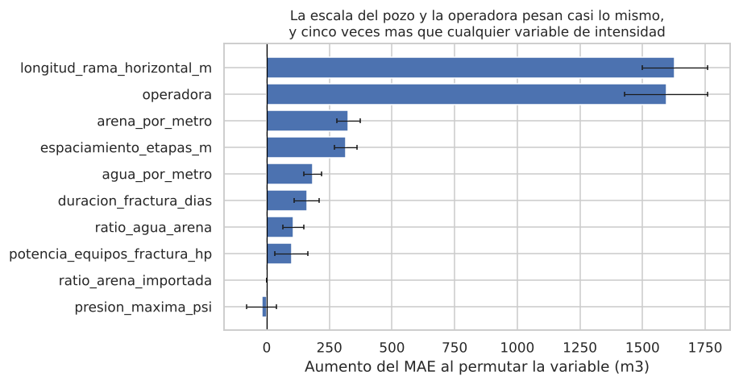
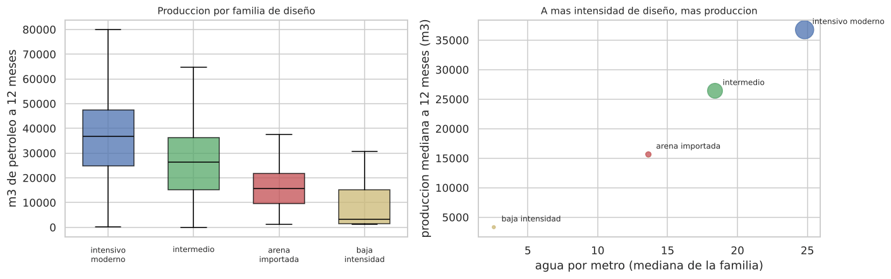

# ¿Cuánto va a producir un pozo en Vaca Muerta antes de fracturarlo?

**Modelo predictivo de producción de petróleo a 12 meses a partir del diseño de completación, con 2.603 pozos reales y una API desplegada.**

`Python` · `pandas` · `scikit-learn` · `FastAPI` · `Docker` · Datos abiertos de la Secretaría de Energía

**▶️ [Probar el modelo en vivo](https://vaca-muerta-carolina.onrender.com/demo)** · [API y documentación](https://vaca-muerta-carolina.onrender.com/docs) · [Presentación (PDF)](docs/presentacion.pdf) · [Informe técnico completo](docs/informe_tecnico.md)

> El servicio corre en una capa gratuita que se duerme tras 15 minutos sin uso: la primera carga puede tardar hasta un minuto.

---

## En 30 segundos

- **La validación aleatoria miente.** El mismo modelo da **R² 0,52** con una partición aleatoria y **0,26** cuando se lo evalúa como se va a usar: entrenado con el pasado y probado en los pozos de 2024-2025. Validar al azar habría reportado el doble de la precisión real.
- **La longitud de la rama horizontal es la mayor palanca de diseño:** unos **+7.400 m³** de petróleo en el primer año por cada ~900 m adicionales. Más arena por metro, en cambio, ya casi no suma.
- **Conviene regresionar y cortar, no clasificar:** para predecir si un pozo será "de los buenos", el regresor cortado en el umbral supera al clasificador (**AUC 0,791 vs. 0,744**).
- **El modelo está en producción:** una API con FastAPI y un panel interactivo que devuelve la estimación, un rango p10–p90 y avisos cuando el pedido sale de lo que el modelo conoce.

## El problema

Para que un pozo no convencional produzca hay que fracturar la roca: se perfora un tramo horizontal de varios kilómetros y se bombea agua con arena a alta presión en decenas de etapas. Cuán larga es la rama, cuántas etapas, cuánta arena y cuánta agua: ese **diseño de completación** concentra buena parte del costo del pozo, y se decide **antes** de saber cuánto va a producir. Sobreinvertir es plata enterrada; subinvertir deja petróleo en el subsuelo.

**Pregunta de negocio:** ¿qué producción de petróleo en el primer año se puede esperar de un diseño de completación, y qué decisiones de diseño la mueven más?

## Datos

Tres datasets abiertos de la Secretaría de Energía de la Nación, incluidos en el repositorio:

| Fuente | Contenido | Registros |
|---|---|---|
| [Datos de fractura (Adjunto IV)](https://datos.energia.gob.ar/dataset/datos-de-fractura-de-pozos-adjunto-iv) | Una fila por operación de fractura: rama, etapas, arena, agua, presión, operadora | 4.890 |
| [Producción por pozo y mes](https://datos.energia.gob.ar/dataset/produccion-de-pozos-de-gas-y-petroleo-por-pozo-y-mes) | Petróleo y gas mensual de cada pozo (recortado de 1,4 GB a 1,3 MB) | 136.380 |
| [Listado de pozos](https://datos.energia.gob.ar/dataset/listado-de-pozos-cargados-por-empresas-operadoras) | Coordenadas, cota y profundidad | 2.282 |

**Alcance:** pozos horizontales con rama de al menos 500 m. Tras la limpieza quedan **2.603 pozos**, el 97% de Vaca Muerta.

## Cómo lo encaramos

1. **Exploración y limpieza** ([notebook 01](notebooks/01_eda_preentrega2.ipynb)). El dataset mezclaba pozos verticales y horizontales, tenía cargas parciales de una misma fractura en varias filas y ceros centinela en presión, agua y rama. Consolidamos por pozo y construimos variables de intensidad (arena y agua por metro, espaciamiento entre etapas) para bajar la multicolinealidad: los VIF pasaron de 7,6 a menos de 5.
2. **Regresión** ([notebook 02](notebooks/02_modelado_preentrega3.ipynb)). Variable objetivo: m³ de petróleo acumulados en los primeros 12 meses. Comparamos regresión lineal, Ridge, Random Forest y Gradient Boosting contra un modelo de referencia, con **partición temporal**: entrenamiento hasta 2023, prueba en 2024-2025.
3. **Clasificación** ([notebook 03](notebooks/03_clasificacion_preentrega3.ipynb)). ¿Va a superar el pozo la producción típica? El umbral se calcula solo con entrenamiento para no filtrar información.
4. **Clustering** ([notebook 04](notebooks/04_clustering_preentrega4.ipynb)). Sin mirar la producción, ¿los pozos se agrupan solos en tipos de diseño?
5. **Puesta en producción** ([`src/`](src)). El mismo `Pipeline` de scikit-learn que se evaluó se sirve en una API con FastAPI, empaquetada con Docker y desplegada en Render.

## Resultados

### La partición importa más que el modelo



| Modelo (prueba: pozos 2024-2025) | MAE (m³) | R² | Mejora vs. referencia |
|---|---|---|---|
| Referencia (mediana) | 14.138 | −0,18 | — |
| Ridge | 10.814 | 0,240 | 23% |
| **Random Forest** | **10.596** | **0,263** | **25%** |
| Gradient Boosting | 10.878 | 0,249 | 23% |

La partición aleatoria le deja ver al modelo pozos de la misma época que después usa para evaluarlo. Como el diseño cambió muchísimo (la rama mediana pasó de 1.411 m en 2016 a 2.996 m en 2025), eso infla la métrica. La validación cruzada lo confirma sin tocar el test: **0,17 temporal contra 0,55 aleatoria**. Y la búsqueda de hiperparámetros (180 combinaciones) no mejoró el test más de lo que lo mueve cambiar la semilla: el modelo elegido a mano se mantuvo.

### Qué variables pesan



La longitud de rama y la operadora pesan casi lo mismo, y cinco veces más que cualquier variable de intensidad. El peso de la operadora **no mide la habilidad de la empresa**: refleja la calidad geológica del área que tiene en concesión, que no está en los datos abiertos.

### Cuatro familias de diseño, y producen distinto



K-Means sobre las variables de intensidad, sin año ni producción, encontró cuatro familias que reconstruyen la evolución histórica del diseño: de "baja intensidad" (2017, 7 etapas) a "intensivo moderno" (2024, 48 etapas). Como la producción quedó fuera del ajuste, compararla es una validación honesta: la mediana va de **3.311 a 36.760 m³** entre familias (Kruskal-Wallis, p ≈ 5·10⁻⁵⁷).

## Qué haría una operadora con esto

1. **Priorizar la longitud de rama:** es la palanca más grande, con ~7.400 m³ más en el primer año por cada ~900 m.
2. **Fracturar más denso antes que bombear más arena por metro:** apretar las etapas suma; la intensidad de arena muestra rendimientos decrecientes desde 2019.
3. **Revisar el gasto en arena importada:** su proporción no se asocia con mayor producción.
4. **Validar cualquier modelo con pozos posteriores a los de entrenamiento:** de lo contrario, se compra el doble de la precisión que realmente tiene.

## La API

```bash
curl -X POST https://vaca-muerta-carolina.onrender.com/predict \
  -H "Content-Type: application/json" -d @ejemplo_pozo.json
```

```json
{
  "prediccion_m3": 38506.0,
  "rango_p10_p90_m3": [26915.1, 49433.9],
  "operadora_conocida": true,
  "avisos": []
}
```

Recibe el diseño tal como se declara (metros de rama, etapas, toneladas de arena, m³ de agua, operadora) y calcula las variables de intensidad con el mismo código que se usó para entrenar. Devuelve un **rango p10–p90** con los votos de los 600 árboles y **avisos** cuando un valor cae fuera de lo que el modelo vio: un Random Forest no extrapola, y sin el aviso un pozo de 8.000 m se estimaría en silencio igual que uno de 5.000.

## Limitaciones

- **Explica el 26% de la variabilidad.** Sirve para comparar carteras de pozos y ordenar decisiones de diseño, no para dictaminar sobre un pozo individual: sobreestima los peores y subestima los mejores.
- **Falta la geología, que es el factor dominante.** Agregar coordenadas y área de concesión no mejoró el test; solo aumentó el sobreajuste.
- **Son asociaciones, no causas.** No hay contrafactual: solo existen los pozos que se perforaron con el diseño que se eligió.
- **Concentración:** YPF aporta el 53% de los pozos y el 97% son de Vaca Muerta.
- **Se degrada con el tiempo:** está validado en 2024-2025; si el diseño sigue cambiando, hay que reentrenar.

## Cómo reproducirlo

```bash
git clone https://github.com/CaroBailon/vaca-muerta-predictive-analytics.git
cd vaca-muerta-predictive-analytics
pip install -r requirements.txt
jupyter notebook          # correr los notebooks en orden: 01 → 04
```

Todos los datos están en el repositorio y las versiones están fijadas, así que los números salen idénticos. El notebook 02 tarda unos 8 minutos por la búsqueda de hiperparámetros.

Para levantar la API en local:

```bash
uvicorn src.app:app --reload     # y abrir http://127.0.0.1:8000/docs
```

## Estructura

```
├── data/          # los tres datasets de la Secretaría de Energía
├── notebooks/     # 01 exploración · 02 regresión · 03 clasificación · 04 clustering
├── src/           # variables, entrenamiento, modelo y API (FastAPI) + panel /demo
├── models/        # Random Forest entrenado y su ficha (metadata.json)
├── docs/          # informe técnico, presentación, guía de despliegue y guion de la demo
├── img/           # gráficos de este README
└── Dockerfile     # imagen para desplegar la API
```

## Equipo y uso de IA

Proyecto final de **EnergIA Digital 2026**, desarrollado por **Carolina Bailon**, Franco Malacalza y Martín Gerbaldo.

Usamos un asistente de IA como copiloto para sintaxis de librerías, revisión de código y redacción. Las decisiones de alcance, metodología e interpretación fueron nuestras, y ninguna cifra entra al texto si no sale de una celda ejecutada. El detalle, con los casos donde revisar cambió la conclusión, está en el [informe técnico](docs/informe_tecnico.md#uso-de-herramientas-de-ia).

---

**Carolina Bailon Trujillo** · Estudiante de Ciencia de Datos en Organizaciones (UNLP) · [LinkedIn](https://www.linkedin.com/in/carolinabailontrujillo/) · [GitHub](https://github.com/CaroBailon)
